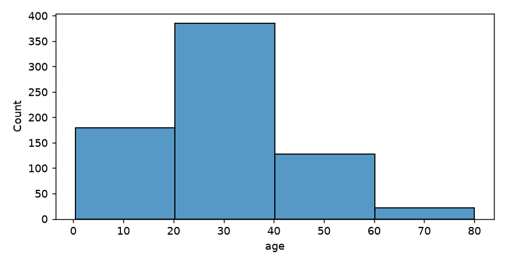
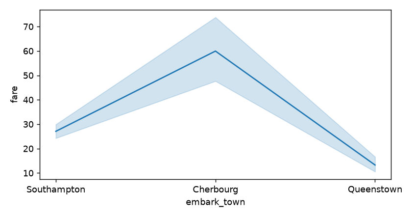

# IS834 — Practice Final Exam Solution (Fall 2026)

```
IS834 — Business Analytics with Python          Practice Final Exam
Fall 2026                                        Wednesday, November 18

Time: 75 minutes.  Total: 95 points.  Four sections, A–D.
Closed book. No notes, internet, or AI tools. No code is run during the exam.

In every code block, assume pandas (as pd), seaborn (as sns), matplotlib.pyplot
(as plt) and the scikit-learn functions it uses are already imported, and DATA is
the course data folder.

"Choose one": exactly one option is correct.
"Choose all that apply": one or more options may be correct. Each correct option
you tick earns its share of the points; each wrong option you tick takes the same
share away. A question never scores below zero, and ticking every option scores zero.

Written answers: keep to the sentence limit given with the question.
A numbered black circle (❶, ❷, ❸) marks something blanked out for you to fill in.
A formula sheet follows this page.
```

---

### Formula sheet

**Confusion matrix**, as `confusion_matrix` prints it: rows are the truth, columns are the prediction.

```
                  predicted False    predicted True
actual False            w                  x
actual True             y                  z
```

| Measure | Formula | In plain English |
| --- | --- | --- |
| Accuracy | (w + z) / (w + x + y + z) | Of all the cases, the share the model got right |
| Precision for a class | correct predictions of that class / all predictions of that class | Of the cases the model **predicted** to be in the class, the share that really were |
| Recall for a class | correct predictions of that class / all cases really in that class | Of the cases **really** in the class, the share the model predicted to be in it |

| Measure | Good value |
| --- | --- |
| MAE (mean absolute error) | Lower is better |
| R² | Closer to 1 is better |

---

#### Section A (20 points)

A grocer's buyer reviews chocolate bars before stocking them. `rating` is an expert's score out of 5. `ingredients` gives the number of ingredients, then a code for each: B = beans, S = sugar, S\* = other sweetener, C = cocoa butter, V = vanilla.

```python
bars = [
    {"origin": "Philippines", "cocoa": "70%", "ingredients": "2- B,S*",    "rating": 3.5},
    {"origin": "Malaysia",    "cocoa": "72%", "ingredients": "2- B,S",     "rating": 2.75},
    {"origin": "Belize",      "cocoa": "86%", "ingredients": "4- B,S,C,V", "rating": 3.25},
    {"origin": "Tanzania",    "cocoa": "80%", "ingredients": "3- B,S,C",   "rating": 3.0},
    {"origin": "Philippines", "cocoa": "77%", "ingredients": "2- B,S",     "rating": 3.75},
]
```

##### Question A1 (9 points)

**Code:**

```python
bar = bars[2]
cocoa = int(bar["cocoa"].replace("%", ""))
parts = bar["ingredients"].split("- ")
codes = parts[1].split(",")

print(cocoa // 10, cocoa % 10)
print(int(parts[0]) == len(codes), codes[-1])
```

**The following is printed:**

```
❶
True V
```

**(a)** (3 points) What is printed at **❶**?

`______________________`

**(b)** (3 points) Choose all that apply. Which statements are true?

- A. `parts[0]` is `4`.
- B. `len(codes)` is `4`.
- C. `"C" in codes` is `True`.
- D. `len(parts)` is `4`.

**(c)** (3 points) Choose one. The second line is changed to `cocoa = int(bar["cocoa"])`. What happens?

- A. `cocoa` holds `86`.
- B. `cocoa` holds `0.86`.
- C. `cocoa` holds `"86%"`.
- D. The line stops with an error.

##### Question A2 (7 points)

**Code:**

```python
counts = {}
for bar in bars:
    counts[bar["origin"]] = counts.get(bar["origin"], 0) + 1

print(counts)
print(len(counts), "Philippines" in counts, 2 in counts)
```

**The following is printed:**

```
{'Philippines': 2, 'Malaysia': 1, 'Belize': 1, 'Tanzania': 1}
❶
```

**(a)** (2 points) What is printed at **❶**?

`______________________`

**(b)** (3 points) Choose one. The line inside the loop is changed to `counts[bar["origin"]] = counts[bar["origin"]] + 1`, and nothing else changes. What happens?

- A. The same dictionary is printed.
- B. Every origin is counted once: `{'Philippines': 1, 'Malaysia': 1, 'Belize': 1, 'Tanzania': 1}`.
- C. An empty dictionary `{}` is printed.
- D. The loop stops with an error on its first pass.

**(c)** (2 points) Choose all that apply. Which statements are true about `counts` as printed above?

- A. After the loop, `counts.get("Ghana", 0)` is `0`.
- B. `counts["Philippines"]` is `2`.
- C. `counts[0]` is `"Philippines"`.
- D. `len(counts)` is `5`.

##### Question A3 (4 points)

**Code:**

```python
shelf = []
for bar in bars:
    cocoa = int(bar["cocoa"].replace("%", ""))
    if cocoa >= 80:
        shelf.append("dark")
    elif bar["rating"] >= 3.5:
        shelf.append("top")
print(shelf)
```

**(a)** (2 points) What is printed?

`______________________`

**(b)** (2 points) Choose one. What does the loop do with the Malaysia bar (`"72%"`, rating 2.75)?

- A. It appends `"dark"`.
- B. It appends `"top"`.
- C. It appends nothing for that bar.
- D. It stops with an error, because there is no `else`.

### Solutions — Section A

**A1(a) —** `8 6`**.** `cocoa` is 86; `//` divides and drops the remainder (8), `%` keeps only the remainder (6).

**A1(b) — B and C.**

- A ✗: `parts[0]` is the text `"4"`, not the number `4`; it becomes a number only inside `int(...)`.
- B ✓: `"B,S,C,V"` split on commas gives `['B', 'S', 'C', 'V']`, four items.
- C ✓: `in` checks membership in a list.
- D ✗: splitting `"4- B,S,C,V"` on `"- "` gives two pieces, `['4', 'B,S,C,V']`.

**A1(c) — D.** `int("86%")` cannot read the `%`, so Python raises a `ValueError`.

- A: assumes `int` ignores the symbol. B: reads `%` as "divide by 100". C: thinks `int` leaves text alone.

**A2(a) —** `4 True False`**.**

- 4 keys; `in` on a dictionary checks the **keys**, so `"Philippines" in counts` is True and `2 in counts` is False, even though 2 is one of the values.

**A2(b) — D.** On the first pass `counts` is empty, so `counts["Philippines"]` does not exist and square brackets raise a `KeyError`; `.get(…, 0)` was what supplied a starting 0.

- A: thinks the two lines are the same. B: thinks a missing key starts at 0 and is then overwritten. C: thinks the error is skipped.

**A2(c) — A and B.**

- A ✓: there is no `"Ghana"` key, so `.get` returns the fallback, 0, without an error. B ✓: read off the dictionary.
- C ✗: dictionaries are read by key, not position; `counts[0]` raises a `KeyError`.
- D ✗: `len(counts)` is `4` — the Philippines appears twice but is one key.

**A3(a) —** `['top', 'dark', 'dark', 'top']`**.**

- Philippines 70%, 3.5: not ≥ 80, but rating ≥ 3.5 → `"top"`. Malaysia: neither → nothing. Belize 86% and Tanzania 80% → `"dark"` (the `elif` is never checked). Philippines 77%, 3.75 → `"top"`.

**A3(b) — C.** 72 is not ≥ 80 and 2.75 is not ≥ 3.5, and with no `else` nothing runs for that bar.

- A / B: picks a branch although neither test is true. D: thinks `if`/`elif` needs an `else`.

---

#### Section B (35 points)

`t` has one row per passenger on the Titanic's only voyage. `survived` is 1 if the passenger survived and 0 if not; `fare` is the ticket price in pounds. Each part starts from `t` exactly as loaded below.

**Code:**

```python
t = pd.read_csv(DATA + "titanic.csv")
t = t[['survived', 'class', 'sex', 'age', 'fare', 'deck', 'embark_town']]
print(t.shape)
t.head(3)
```

**The following is printed:**

```
(891, 7)
```

|  | survived | class | sex | age | fare | deck | embark_town |
| --- | --- | --- | --- | --- | --- | --- | --- |
| **0** | 0 | Third | male | 22.0 | 7.2500 | NaN | Southampton |
| **1** | 1 | First | female | 38.0 | 71.2833 | C | Cherbourg |
| **2** | 1 | Third | female | 26.0 | 7.9250 | NaN | Southampton |

##### Question B1 (20 points)

**(a)** (4 points)

**Code:**

```python
print(t.duplicated().sum())
```

**The following is printed:**

```
115
```

A colleague says the file lists 115 passengers twice and wants to delete those rows before the analysis. Is that right? Explain why or why not. *(Maximum: 2 sentences.)*

**(b)** (5 points)

**Code:**

```python
t['age_clean'] = t['age'].fillna(0)
print(round(t['age'].mean(), 1), round(t['age_clean'].mean(), 1))
```

**The following is printed:**

```
29.7 23.8
```

A report gives the passengers' average age as 23.8. What is wrong with that number? *(Maximum: 2 sentences.)*

**(c)** (4 points)

**Code:**

```python
survivors = t[t.survived == 1]
survivors['class'].value_counts(normalize=True).round(2)
```

**The following is printed:**

```
class
First     0.40
Third     0.35
Second    0.25
Name: proportion, dtype: float64
```

Choose all that apply. Which statements does this output support?

- A. 40% of the survivors were travelling in First class.
- B. 40% of the First-class passengers survived.
- C. More Third-class passengers survived than Second-class passengers.
- D. Most of the survivors were travelling in First class.

**(d)** (4 points)

**Code:**

```python
upper = t[t['class'].isin(['First', 'Second'])]
rest = t[~t['class'].isin(['First', 'Second'])]
print(upper.shape)
```

**The following is printed:**

```
(400, 7)
```

Choose one. How many rows does `rest` have, and who is in it?

- A. 400 — the First- and Second-class passengers again.
- B. 491 — the Third-class passengers.
- C. 891 — every passenger.
- D. 0 — `~` removes every row.

**(e)** (3 points)

The shipping line wants a VIP mailing list: the five highest-paying passengers who boarded at Southampton.

Choose one. Which line produces that list?

- A. `t[t['embark_town'] == 'Southampton'].sort_values('fare', ascending=False).head(5)`
- B. `t.sort_values('fare', ascending=False).head(5)`
- C. `t[t['embark_town'] == 'Southampton'].sort_values('fare').head(5)`
- D. `t[t['embark_town'] == 'Southampton'].head(5).sort_values('fare', ascending=False)`

##### Question B2 (15 points)

**(a)** (4 points)

**Code:**

```python
t[['survived', 'age', 'fare']].corr().round(2)
```

**The following is printed:**

```
          survived   age  fare
survived      1.00 -0.08  0.26
age          -0.08  1.00  0.10
fare          0.26  0.10  1.00
```

Choose all that apply. Which statements does this output support?

- A. Passengers who paid more tended to survive more often.
- B. Had the ticket prices been raised, more passengers would have survived.
- C. Age had a strong link with survival.
- D. Of the three pairs, fare and survival move together most strongly.

**(b)** (6 points)

**Code:**

```python
sns.histplot(data=t, x="age", bins=4)
plt.show()
```

**Figure 1:**



From this chart, a colleague concludes that the passengers under 20 were spread evenly across those ages. Do you agree? Explain why or why not. *(Maximum: 2 sentences.)*

**(c)** (5 points)

**Code:**

```python
sns.lineplot(data=t, x="embark_town", y="fare")
plt.show()
```

**Figure 2:**



Why is a line the wrong way to compare the average fare across the three ports, and what kind of chart should replace it? *(Maximum: 2 sentences.)*

### Solutions — Section B

**B1(a) — No. With no passenger ID or name,** `duplicated()` **only finds rows whose seven values are all the same, and different passengers can share class, sex, age, fare, deck and port (for example several men in Second class on a free ticket).**

**B1(b) — Filling the gaps with 0 treats the 177 passengers whose age is unknown as newborns, so the average is pulled down and underestimates the passengers' real age; the average of the known ages is 29.7.**

**B1(c) — A and C.** The shares are taken among the 342 survivors only.

- A ✓: 0.40 of the survivors are First class.
- B ✗: turns the share around — that would need the First-class passengers as the base. (Actually 63% of First class survived.)
- C ✓: both shares are of the same 342 survivors, so 0.35 > 0.25 means more people.
- D ✗: 40% is the largest share but not most (more than half).

**B1(d) — B.** `~` turns "class is First or Second" into its opposite, so `rest` holds every other passenger: the Third class, 891 − 400 = 491 rows.

- A: ignores the `~`. C: thinks `~` cancels the filter. D: thinks `~` empties the table.
- `class` has no missing values in this file, so every row is in exactly one of the two tables.

**B1(e) — A.** Keep only the Southampton passengers, put the highest fares first, then take the top five.

- B ✗: no filter; the top five fares overall include the three £512 tickets bought at Cherbourg.
- C ✗: `sort_values` puts the smallest first by default, so this lists the five cheapest (all £0).
- D ✗: `head(5)` runs before the sort, so it takes the first five Southampton rows in the file and only puts those in order.

**B2(a) — A and D.**

- A ✓: 0.26 is positive.
- B ✗: correlation is not cause — fare stands for class and cabin position.
- C ✗: −0.08 is close to 0.
- D ✓: 0.26 is the largest of 0.26, −0.08 and 0.10 in size.

**B2(b) — No. All the under-20s fall in a single bar, and one bar only gives their total (about 180), not how they spread across ages 0–20; redraw with more bins before saying anything about the spread.**

**B2(c) — The ports are three separate labels with no order between them, so the slopes connecting them mean nothing; a bar chart of the average fare per port (**`sns.barplot`**) shows the comparison.**

---

#### Section C (20 points)

A restaurant records every bill. `tip` and `total_bill` are in dollars.

**Code:**

```python
print(tips.shape)
tips.head(3)
```

**The following is printed:**

```
(244, 7)
```

|  | total_bill | tip | sex | smoker | day | time | size |
| --- | --- | --- | --- | --- | --- | --- | --- |
| **0** | 16.99 | 1.01 | Female | No | Sun | Dinner | 2 |
| **1** | 10.34 | 1.66 | Male | No | Sun | Dinner | 3 |
| **2** | 21.01 | 3.50 | Male | No | Sun | Dinner | 3 |

##### Question C1 (10 points)

**Code:**

```python
tips['tip_pct'] = tips['tip'] / tips['total_bill']
(tips
 .groupby('time', as_index=False)
 .agg(avg_tip=('tip', 'mean'),
      avg_pct=('tip_pct', 'mean'))
 .round(3))
```

**The following is printed:**

|  | time | avg_tip | avg_pct |
| --- | --- | --- | --- |
| **0** | Dinner | 3.103 | 0.160 |
| **1** | Lunch | 2.728 | 0.164 |

**(a)** (4 points) Choose all that apply. Which statements about this code are true?

- A. The table has one row for each value in the `time` column.
- B. `as_index=False` keeps `time` as an ordinary column, which is why the rows are labelled `0` and `1`.
- C. The `groupby` statement adds new columns (`avg_tip`, `avg_pct`) to `tips`.
- D. Changing `('tip', 'mean')` to `('tip', 'max')` would rename the `avg_tip` column to `max`.

**(b)** (4 points) Suppose the two statements are swapped, so that the line `tips['tip_pct'] = tips['tip'] / tips['total_bill']` comes after the `groupby` statement. Would the output change? Why or why not? *(Maximum: 2 sentences.)*

**(c)** (2 points) Choose one. The manager also wants the number of bills at lunch and at dinner in the same table. Which change to the code does that?

- A. Add `n_bills=('tip', 'count')` inside `.agg(...)`.
- B. Add `.sum()` after `.round(3)`.
- C. Add `.count()` after `.round(3)`.
- D. Change `.groupby('time', ...)` to `.groupby(['time', 'size'], ...)`.

##### Question C2 (10 points)

**Code:**

```python
daily = tips.groupby('day', as_index=False)['tip'].sum()
staff = pd.DataFrame({'day': ['Thur', 'Fri', 'Sat', 'Sun'],
                      'servers': [3, 2, 5, 4]})
per_server = pd.merge(daily, staff, on='day')
per_server['tip_each'] = (per_server['tip'] / per_server['servers']).round(2)
per_server
```

**The following is printed:**

|  | day | tip | servers | tip_each |
| --- | --- | --- | --- | --- |
| **0** | Fri | 51.96 | 2 | 25.98 |
| **1** | Sat | 260.40 | 5 | 52.08 |
| **2** | Sun | 247.39 | 4 | 61.85 |
| **3** | Thur | 171.83 | 3 | 57.28 |

**(a)** (4 points) Choose all that apply. Which statements about this code are true?

- A. `daily` has one row per day, holding the sum of that day's tips.
- B. `on='day'` matches each row of `daily` with the row of `staff` that has the same `day`.
- C. The `tip` column in `per_server` holds the same values as the `tip` column in `tips`.
- D. Writing `pd.merge(staff, daily, on='day')` instead would change the `tip_each` values.

**(b)** (3 points) Choose one. Suppose `staff` had no row for Friday, and nothing else changed. How many rows would `per_server` have?

- A. 2
- B. 3
- C. 4
- D. 244

**(c)** (3 points)

**Code:**

```python
pd.crosstab(tips.day, tips.time)
```

**The following is printed:**

```
time  Dinner  Lunch
day
Fri       12      7
Sat       87      0
Sun       76      0
Thur       1     61
```

What do the numbers in this table represent, and what does the 0 for Saturday lunch mean? *(Maximum: 2 sentences.)*

### Solutions — Section C

**C1(a) — A and B.**

- A ✓: `groupby('time')` makes one group per value, Dinner and Lunch, and `.agg` returns one row each.
- B ✓: with `as_index=False`, `time` stays a column and the rows get a plain 0, 1 index.
- C ✗: the first line assigns into `tips` (`tips['tip_pct'] = ...`); the `groupby` statement builds a new two-row table that is only printed, so `tips` keeps its own columns.
- D ✗: in a named aggregate the name on the left (`avg_tip=`) is the column name; `'max'` only changes what is computed, so the column is still `avg_tip` (now holding the largest tip).

**C1(b) — Yes: the** `groupby` **statement would stop with an error instead of printing the table, because** `avg_pct=('tip_pct', 'mean')` **asks for a** `tip_pct` **column that does not exist in** `tips` **yet.**

**C1(c) — A.** A named aggregate with `'count'` adds a column of bills per group (Dinner 176, Lunch 68).

- B: `.sum()` on the finished table adds up each column (lunch and dinner averages together), replacing the table; it never counts bills.
- C: `.count()` on the finished table counts the values in each column (2 each), replacing the table.
- D: splits each time further by party size, so there are more rows, but still no count column.

**C2(a) — A and B.**

- A ✓: `groupby('day', …)['tip'].sum()` gives one row per day with the total of its tips.
- B ✓: `on='day'` is the key the two tables are matched on.
- C ✗: the name is the same, but `per_server['tip']` comes from `daily`, so it holds each day's total of tips (four values), not the 244 individual tips in `tips`.
- D ✗: swapping the tables changes the order of rows and columns only; each day is still matched with its own servers, so `tip_each` is the same.

**C2(b) — B, 3.** `pd.merge` without `how=` is an inner join, so Friday, with no match, drops out.

- C 4: thinks the default keeps every row of the left table. A 2: drops a second day. D 244: thinks the merge goes back to the bills.

**C2(c) — Each number is how many rows (bills) of** `tips` **have that day and that time; the 0 means there is no Saturday lunch bill in the data at all.**

---

#### Section D (20 points)

A car maker studies older models before designing new ones. `cars` has one row per car model; `weight` is in pounds and `mpg` is miles per gallon. `high_mileage` is True when `mpg` is 30 or more.

**Code:**

```python
cars = pd.read_csv(DATA + "cars.csv")
cars.head(3)
```

**The following is printed:**

|  | name | model_year | origin | cylinders | weight | mpg | high_mileage |
| --- | --- | --- | --- | --- | --- | --- | --- |
| **0** | chevrolet chevelle malibu | 70 | usa | 8 | 3504 | 18.0 | False |
| **1** | buick skylark 320 | 70 | usa | 8 | 3693 | 15.0 | False |
| **2** | plymouth satellite | 70 | usa | 8 | 3436 | 18.0 | False |

`origin` takes three values: `usa`, `japan` and `europe`.

##### Question D1 (10 points)

**(a)** (4 points)

**Code:**

```python
X = pd.get_dummies(cars[['weight', 'origin']], columns=['origin'])
X.head(3)
```

**The following is printed:**

|  | weight | origin_europe | origin_japan | origin_usa |
| --- | --- | --- | --- | --- |
| **0** | 3504 | False | False | True |
| **1** | 3693 | False | False | True |
| **2** | 3436 | False | False | True |

Choose all that apply. Which statements are true?

- A. A car with a missing `origin` gets `True` in one of the `origin_` columns, chosen by default.
- B. If `weight` were also listed in `columns=`, `get_dummies` would group the weights into a few bins.
- C. Running `X = pd.get_dummies(...)` leaves `cars` unchanged, still with its one `origin` column.
- D. If `origin` had a fourth value, `X` would have four `origin_` columns.

**Code:**

```python
X = pd.get_dummies(cars[['weight', 'model_year', 'cylinders', 'origin']],
                   columns=['origin'])
y = cars['high_mileage']
X_train, X_test, y_train, y_test = train_test_split(
    X, y, test_size=0.2, random_state=595, stratify=y)

model = DecisionTreeClassifier(max_depth=3, min_samples_leaf=20, random_state=595)
model.fit(X_train, y_train)
y_pred = model.predict(X_test)

print("accuracy:", round(accuracy_score(y_test, y_pred), 3))
print(pd.DataFrame(confusion_matrix(y_test, y_pred),
                   index=["actual False", "actual True"],
                   columns=["predicted False", "predicted True"]))
```

**The following is printed:**

```
accuracy: 0.887
              predicted False  predicted True
actual False               57               5
actual True                 4              14
```

**(b)** (3 points) Choose all that apply. Which statements about this code are true?

- A. `max_depth=3` lets the tree ask at most three questions before it reaches a prediction.
- B. The tree is built from 80% of the cars.
- C. `random_state=595` makes this tree more accurate than other values would.
- D. `model.fit(X_train, y_train)` also looks at the test cars when it builds its rules.

**(c)** (3 points) The company will advertise every car that the model predicts to be high-mileage. It wants as few of those adverts as possible to be for cars that are not really high-mileage. Choose one. Which number best shows how well the model does at that?

- A. 0.887
- B. 14 / 19
- C. 14 / 18
- D. 57 / 62

##### Question D2 (10 points)

The analyst now predicts `mpg` itself.

**Code:**

```python
X = cars[['weight', 'model_year']]
y = cars['mpg']
X_train, X_test, y_train, y_test = train_test_split(X, y, test_size=0.2, random_state=595)

rows = []
for depth in [1, 2, 4, 8, 16]:
    tree = DecisionTreeRegressor(max_depth=depth, random_state=595)
    tree.fit(X_train, y_train)
    rows.append({"max_depth": depth,
                 "train R2": r2_score(y_train, tree.predict(X_train)),
                 "test R2": r2_score(y_test, tree.predict(X_test))})
pd.DataFrame(rows).round(2)
```

**The following is printed:**

|  | max_depth | train R2 | test R2 |
| --- | --- | --- | --- |
| **0** | 1 | 0.55 | 0.58 |
| **1** | 2 | 0.73 | 0.72 |
| **2** | 4 | 0.89 | 0.81 |
| **3** | 8 | 0.98 | 0.69 |
| **4** | 16 | 1.00 | 0.69 |

**(a)** (4 points) Choose all that apply. Which statements are true?

- A. The tree with `max_depth=1` is underfitting.
- B. The tree with `max_depth=16` is overfitting.
- C. `max_depth=16` is the best choice, because it fits the training cars perfectly.
- D. `max_depth=8` is a better choice than `max_depth=4`.

**Code:**

```python
model_a = LinearRegression()
model_a.fit(X_train, y_train)
model_b = LinearRegression()
model_b.fit(X_train, y_train)
diff = model_a.predict(X_test) - model_b.predict(X_test)
sns.histplot(diff)
plt.show()
```

**(b)** (3 points) Choose one. What will the histogram show?

- A. A single bar at 0: the two models give every test car the same prediction.
- B. A spread of small differences around 0, because each fit starts from random values.
- C. Two separate bars, one for each model's predictions.
- D. No chart: the code stops with an error, because the same data cannot be fit twice.

**(c)** (3 points) Choose all that apply. The company has more questions about its new designs. Which of them call for a **regression** model?

- A. How many miles per gallon will this design get?
- B. Will this design pass the emissions test?
- C. How many pounds will this design weigh, given its engine size?
- D. Which of the three regions will this design be sold in?

### Solutions — Section D

**D1(a) — C and D.**

- A ✗: there is no default column; a car with a missing `origin` gets `False` in every `origin_` column.
- B ✗: `get_dummies` never bins; it makes one column per distinct value, so listing `weight` would add a `weight_…` column for each of the 351 different weights.
- C ✓: `get_dummies` returns a new table, which is stored in `X`; nothing is assigned back to `cars`, so `cars` still has its single text column `origin`.
- D ✓: one column per value, so a fourth origin adds a fourth column.

**D1(b) — A and B.**

- A ✓: `max_depth` is how many questions the tree may ask in a row.
- B ✓: `test_size=0.2` keeps 20% of the cars back for testing, and `fit` uses `X_train`, the other 80% (318 of 398).
- C ✗: `random_state` only fixes the random choices so the result is the same every run; it is not a setting that improves accuracy.
- D ✗: `fit` sees only `X_train` and `y_train`; the test cars are kept out so they can be used to check the model afterwards.

**D1(c) — B, 14 / 19.** Of the 19 cars the model predicts to be high-mileage, 14 really are: the precision for the high-mileage class, which is what "few adverts for the wrong cars" needs.

- A 0.887: overall accuracy, which mixes both kinds of mistakes.
- C 14 / 18: of the cars that really are high-mileage, how many the model found (recall); it ignores the 5 wrong adverts.
- D 57 / 62: how well it recognises the cars that are not high-mileage, the other class.

**D2(a) — A and B.**

- A ✓: low on both training and test (0.55 / 0.58) — too simple.
- B ✓: perfect on training, 0.69 on test — a large gap.
- C ✗: training scores reward memorising.
- D ✗: on new cars `max_depth=4` does better (test R² 0.81 vs 0.69); the extra training fit is memorising.

**D2(b) — A.** `LinearRegression` has no randomness: fitting it twice on the same training cars gives exactly the same line, so all 80 differences are 0.

- B ✗: unlike `train_test_split` or a tree's `random_state`, a linear fit does not start from random values.
- C ✗: `diff` is one number per test car (model A minus model B), not the two sets of predictions.
- D ✗: each `LinearRegression()` is a separate model, and the same data can be fit as often as you like.

**D2(c) — A and C.**

- A ✓ and C ✓ predict a number. B ✗ (pass or fail: two classes) and D ✗ (one of three regions) are classification.
