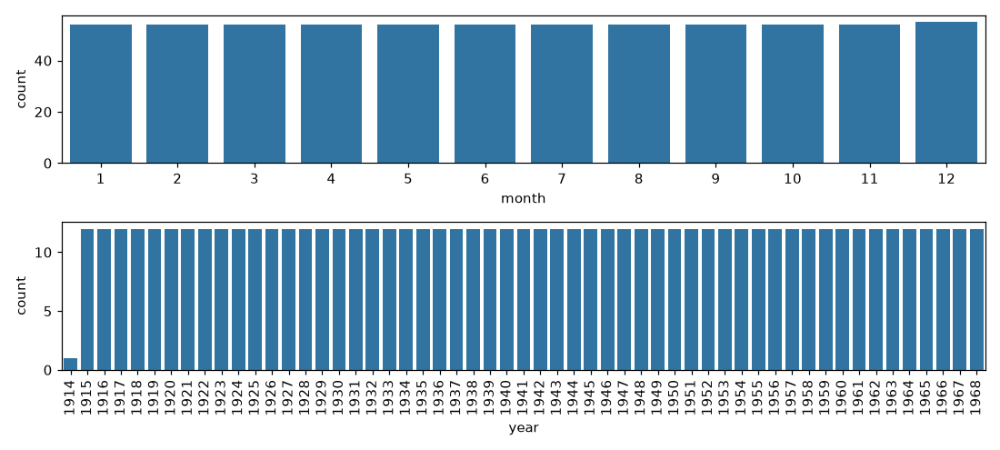

# IS834 — Quiz 3 Solution

**Fall 2026 · Quiz given Thursday, October 29 · 20 points**

---

### The dataset

Every question uses the DataFrame `dow`: the Dow Jones stock index, one row per month from December 1914 to December 1968. Three of its rows:

| | Price | year | month | decade |
|---|---|---|---|---|
| **420** | 196.62 | 1949 | 12 | 1940 |
| **539** | 646.43 | 1959 | 11 | 1950 |
| **582** | 719.14 | 1963 | 6 | 1960 |

---

### Question 1 (5 points)

An analyst summarises the index by decade.

**(a)** (3 points) The analyst wants each decade's average `Price`. Fill in the three blanks.

```python
dow.groupby(❶, as_index=False)[❷].❸()
```

> **Answer:** ❶ `'decade'` ❷ `'Price'` ❸ `mean`
>
> **Why:** You group by the column that defines the groups (`decade`), pick the column to summarise in the brackets (`Price`), and name the summary last (`mean`).

**(b)** (2 points)

**Code:**

```python
table = pd.pivot_table(dow, index='decade', columns='month',
                       values='Price', aggfunc='mean').round()
table
```

**The following is printed:**

```
month       1      2      3      4      5      6      7      8      9     10     11     12
decade
1910     81.0   81.0   82.0   84.0   86.0   88.0   89.0   89.0   91.0   95.0   94.0   85.0
1920    140.0  140.0  140.0  141.0  141.0  141.0  146.0  152.0  155.0  148.0  145.0  150.0
1930    137.0  140.0  140.0  135.0  132.0  132.0  135.0  138.0  134.0  130.0  129.0  126.0
1940    153.0  152.0  152.0  153.0  152.0  153.0  155.0  155.0  154.0  156.0  156.0  156.0
1950    369.0  369.0  375.0  380.0  384.0  387.0  398.0  400.0  398.0  395.0  401.0  411.0
1960    783.0  781.0  778.0  793.0  789.0  777.0  776.0  777.0  785.0  786.0  796.0  802.0
```

Circle one. What does the number **375.0**, in row `1950` and column `3`, represent?

- A. The Dow Jones price on March 1, 1950.
- B. The average price over every month from 1950 to 1959.
- C. The average price over the ten Marches from 1950 to 1959.
- D. The total of the ten March prices from 1950 to 1959.

> **Answer:** C
>
> **Why:** The row is the decade (1950s), the column is the month (3 = March), and `aggfunc='mean'` averages every price that falls in that cell: the ten March prices of the 1950s.
>
> - **A** is wrong: a pivot cell is a summary of many rows, not the price of a single month.
> - **B** is wrong: that ignores `columns='month'`, which splits each decade into its twelve months.
> - **D** is wrong: `aggfunc='mean'` takes the average, not the total.

---

### Question 2 (4 points)

The analyst wants to mark the years in which a major event happened.

**Code:**

```python
yearly = dow.groupby('year', as_index=False)['Price'].mean()
print(yearly.shape)
events = pd.DataFrame({'year':  [1929, 1941, 1945, 1971],
                       'event': ['Market crash', 'US enters WWII', 'WWII ends', 'Nasdaq opens']})
# the years with no event on record
merged = pd.merge(yearly, events, on='year', how='inner')
no_event = merged[merged['event'].isna()]
```

**The following is printed:**

```
(55, 2)
```

How many rows does `no_event` have? Explain why. *(Maximum: 2 sentences.)*

> **Answer:** 0 rows.
>
> **Why:** An inner join keeps only the years found in **both** tables (1929, 1941, 1945), so the years without an event are dropped by the merge itself. Every row left in `merged` has an event, so `.isna()` finds nothing.

---

### Question 3 (3 points)

Each row of `dow` records the index's price on the first day of that month. The analyst draws two bar charts.

**Code:**

```python
fig, axes = plt.subplots(2, 1, figsize=(10, 4.5))
sns.countplot(data=dow, x="month", ax=axes[0])
sns.countplot(data=dow, x="year", ax=axes[1])
axes[1].tick_params(axis='x', rotation=90)
plt.tight_layout()
plt.show()
```

**The following is displayed:**



Both bar charts are almost perfectly flat. Why? *(Maximum: 2 sentences.)*

> **Answer:** The data has one row per month, so every year has 12 rows (except 1914, which starts in December) and every month has 54 rows (55 for December).

---

### Question 4 (8 points)

The analyst adds one more column to `dow`: whether it **rained** in New York on the first day of that month (yes or no). The analyst wants a model that predicts whether it rained, from `Price`, `month` and `year`.

**(a)** (2 points) Circle one. This is a: **SUPERVISED** / **UNSUPERVISED** learning problem.

> **Answer:** SUPERVISED
>
> **Why:** The data has a target column (`rained`, yes or no) recorded for every month, and the model learns from those known target values to predict months it has not seen.

The analyst splits the months into a training set and a test set, fits two different ML models on the training set, and scores both:

| Model | Accuracy on the training set | Accuracy on the test set |
|---|---|---|
| Model A | 0.65 | 0.62 |
| Model B | 1.00 | 0.55 |

**(b)** (3 points) Circle one. Which statement is best supported by this table?

- A. Model B is the better model, because it is perfect on the months it learned from.
- B. Model A is the better model, because it scores lower on the months it learned from.
- C. Model B is overfitting: it is perfect on the months it learned from but does worse on months it has never seen.
- D. Model B is underfitting, because it does worse on months it has never seen.

> **Answer:** C
>
> **Why:** A perfect training score with a drop on the test set means Model B memorised the months it learned from.
>
> - **A** is wrong: a model is judged on months it has never seen (the test set), and there Model B is the worse of the two.
> - **B** is wrong: a lower score on the months a model learned from is not what makes it better; Model A is better because it scores higher on the test set.
> - **D** is wrong: underfitting means low scores on both sets, but Model B is perfect on the training set.

**(c)** (3 points) Neither model does well on months it has never seen. What is the most likely reason? *(Maximum: 2 sentences.)*

> **Answer:** `Price`, `month` and `year` have nothing to do with whether it rains, so there is no pattern connecting the inputs to the target. A model can only learn a pattern that is actually in the data; here it is just learning noise.
